# Kurogane Digital — домашняя лаборатория ИТ-инфраструктуры

> **In English.** A Hyper-V homelab that recreates the Windows infrastructure of a fictional 20-person game studio: two domain controllers with DNS and DHCP failover, a file server, Exchange Server SE, an enterprise PKI, Group Policy, backups verified by restore, a print server, and an Ubuntu server joined to AD that runs Docker with a GLPI service desk (AD sign-in over LDAPS, HTTPS behind an nginx reverse proxy, tickets by email through Exchange), an intranet portal, and monitoring with Prometheus, Grafana and Alertmanager (windows_exporter deployed by Group Policy, email alerts through Exchange). Every step is documented in a lab journal, including 83 troubleshooting cases with root causes. Documentation is in Russian.

Лаборатория воспроизводит инфраструктуру вымышленной игровой студии **Kurogane Digital** (黒鉄, «чёрная сталь»): около 20 сотрудников в семи отделах, игра под NDA, поэтому строгое разграничение доступа. Всё развёрнуто на одном ПК под Hyper-V на Windows Server 2025, Windows 11 и Ubuntu Server.

Цель — практика системного администрирования на задачах, близких к реальной компании: не «установил роль», а «настроил, проверил и разобрал, что сломалось и почему». Каждый этап записан в [журнал](docs/journal.md) вместе с тем, как проверялся результат.

**Стек:** Windows Server 2025 · Active Directory DS · DNS · DHCP Failover · Group Policy · Windows LAPS · FSRM · Exchange Server SE · AD CS · Windows Server Backup · Print Server · PowerShell · Hyper-V · Ubuntu Server · SSSD · Docker Compose · nginx · GLPI · MariaDB · Prometheus · Grafana · Alertmanager

## Схема

| Машина | Роль | Адрес |
| --- | --- | --- |
| DC01 | AD DS, DNS, DHCP (активный), все роли FSMO, глобальный каталог | 192.168.100.10 |
| DC02 | AD DS, DNS, DHCP Failover (ждущий), глобальный каталог | 192.168.100.11 |
| FS01 | Файловый сервер, FSRM, теневые копии, центр сертификации, сервер печати | 192.168.100.30 |
| EX01 | Exchange Server SE (SU11), две базы почтовых ящиков | 192.168.100.20 |
| APP01 | Ubuntu Server в домене; Docker за обратным прокси nginx: Service Desk GLPI (`helpdesk.kurogane-digital.ru`), портал сотрудников (`intranet`), мониторинг Prometheus + Grafana + Alertmanager (`grafana`) | 192.168.100.40 |
| WS-DEV01, WS-DESIGN01 | Рабочие места отделов Dev и Design, Windows 11 | DHCP |

Лес `corp.kurogane.test`, почтовый домен и UPN — `kurogane-digital.ru`. Сеть изолирована: внутренний коммутатор Hyper-V, наружу — только через NAT на хосте.

## Что сделано

| Этап | Коротко | Подтверждение |
| --- | --- | --- |
| Active Directory | Лес с двумя контроллерами домена, репликация, сайт, время от PDC; структура OU по отделам; пользователи и группы создаются скриптом из CSV | [repadmin и dcdiag](screenshots/03-replication.png), [скрипты](scripts/ad) |
| DHCP Failover | Горячая замена между DC01 и DC02; отказ основного сервера проверен | [журнал](docs/journal.md#что-сделано) |
| Файловый сервер | Права по модели AGDLP, Access-Based Enumeration, квоты и блокировка файлов FSRM, теневые копии, личные папки | [журнал](docs/journal.md#что-сделано) |
| Групповые политики | 15 GPO: пароли и Fine-Grained Password Policy, Windows LAPS, диски и перенаправление папок по группам, запрет USB, вход на серверы, принтеры | [дерево GPO](screenshots/02-gpo-tree.png), [отчёт по всем GPO](docs/gpo-report.html) |
| Exchange Server SE | Установка по документации Microsoft, обновление безопасности, аудит HealthChecker; общие ящики и переговорные с правами через группы, динамические рассылки, смена почтового домена и UPN | [трекинг письма](screenshots/05-message-tracking.png) |
| PKI | Корпоративный корневой центр сертификации AD CS, свой шаблон, SAN-сертификат для Exchange, Download Domains | [сертификат в браузере](screenshots/04-owa-certificate.png) |
| Резервное копирование | Windows Server Backup на всех серверах, бэкап ключа ЦС; восстановление проверено: файл, объект AD, письмо через Recovery Database | [сводка по серверам](screenshots/06-backup-summary.png) |
| Тест отказа | DC01 выключен: вход, DNS и DHCP работают через DC02; передача ролей FSMO и возврат | [журнал](docs/journal.md#что-сделано) |
| Печать | Сервер печати, развёртывание принтеров по отделам через GPO, защита после PrintNightmare; два типа драйверов рядом — v4 (Microsoft PCL6 Class) и v3 (HP Universal Print Driver, предустановка скриптом от SYSTEM, сертификат издателя через GPO); служба печати отключена на контроллерах домена | [принтеры на сервере](screenshots/07-printers.png), [скрипт драйверов](scripts/printing/Install-PrinterDrivers.ps1) |
| Linux в домене | Ubuntu Server введён в AD через realmd/SSSD: вход по SSH и sudo только для группы ИТ, время с контроллеров домена, A и PTR в DNS регистрируются сами | [конфиги](configs/app01/system) |
| Docker | Docker Engine и Compose из официального репозитория, ротация логов; управление только через sudo — группа docker равносильна root | [журнал](docs/journal.md#что-сделано) |
| Service Desk (GLPI) | GLPI 12 и MariaDB в Docker Compose; вход сотрудников из AD по LDAPS с проверкой сертификата, роли по группам AD; HTTPS через обратный прокси nginx с сертификатом своего ЦС; письмо на helpdesk@ становится заявкой, уведомления и ответы идут через Exchange; реальный IP клиента в журналах | [заявка из письма](screenshots/13-glpi-ticket.png), [конфиги](configs/app01) |
| Портал сотрудников | Внутренний сайт студии в контейнере nginx без открытых портов, HTTPS через тот же обратный прокси с сертификатом своего ЦС | [скриншот](screenshots/14-intranet.png), [конфиги](configs/app01/intranet) |
| Мониторинг | Prometheus, Grafana и Alertmanager в Docker на APP01; windows_exporter на всех серверах через GPO: сценарий автозагрузки выбирает сборщики по ролям сервера, порт открыт только для APP01. Тревоги: недоступность сервера, остановка ключевых служб по ролям, место на дисках, квоты FSRM, расхождение времени на DC; каждая проверена настоящей поломкой. Письма о тревоге и о восстановлении идут через Exchange (SMTP 587, TLS, служебная учётка) | [схема](screenshots/08-monitoring.png), [дашборд](screenshots/10-grafana-windows.png), [правила тревог](screenshots/12-alert-rules.png), [письмо о тревоге](screenshots/09-alert-email.png), [конфиги](configs/app01/monitoring), [скрипт](scripts/monitoring/Install-WindowsExporter.ps1) |

## Скриншоты

| | |
| --- | --- |
| <a href="screenshots/02-gpo-tree.png">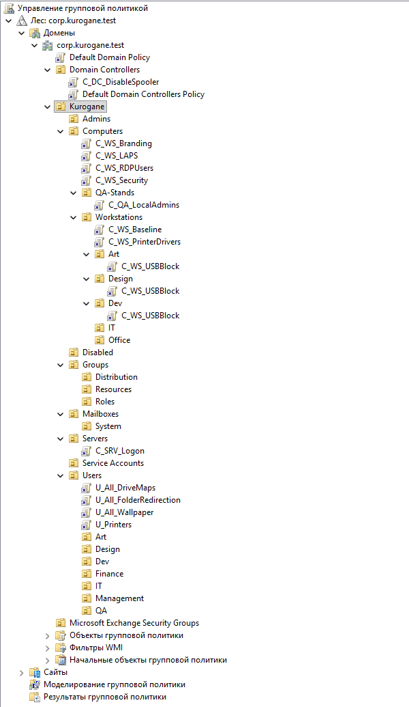</a> Структура OU и групповые политики | <a href="screenshots/03-replication.png">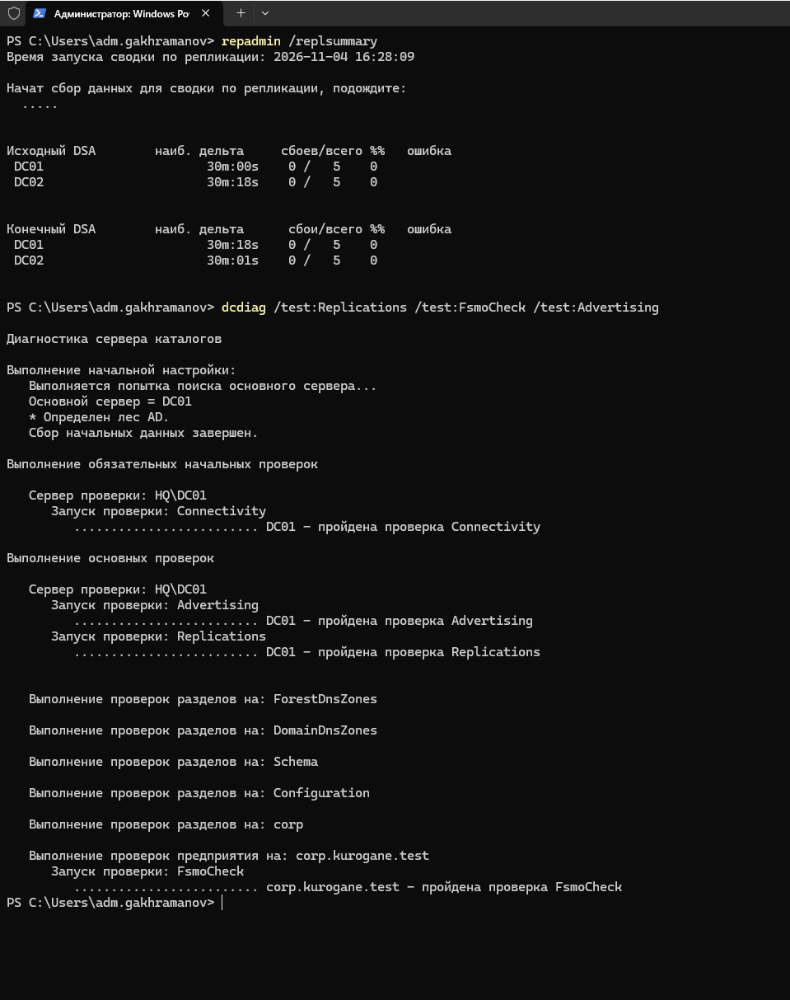</a> Репликация без ошибок: repadmin и dcdiag |
| <a href="screenshots/04-owa-certificate.png">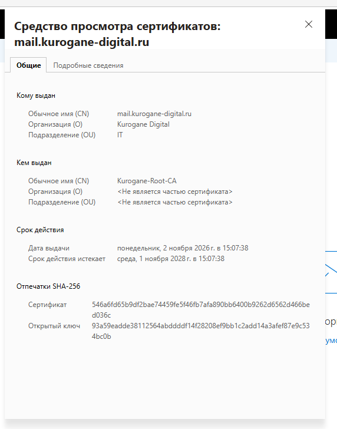</a> Сертификат Exchange от своего центра сертификации | <a href="screenshots/05-message-tracking.png">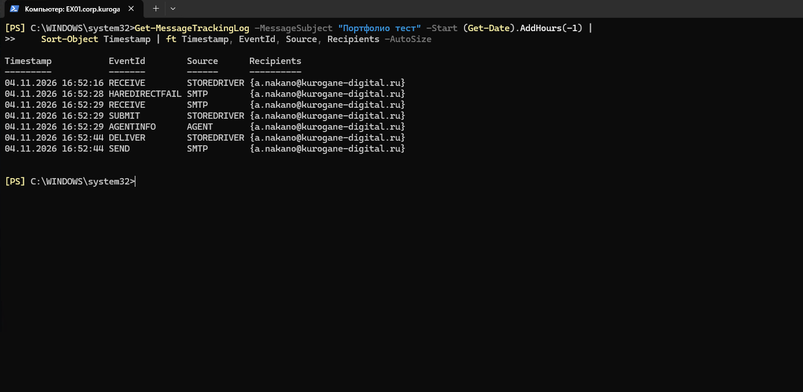</a> Путь письма по журналу трекинга |
| <a href="screenshots/06-backup-summary.png">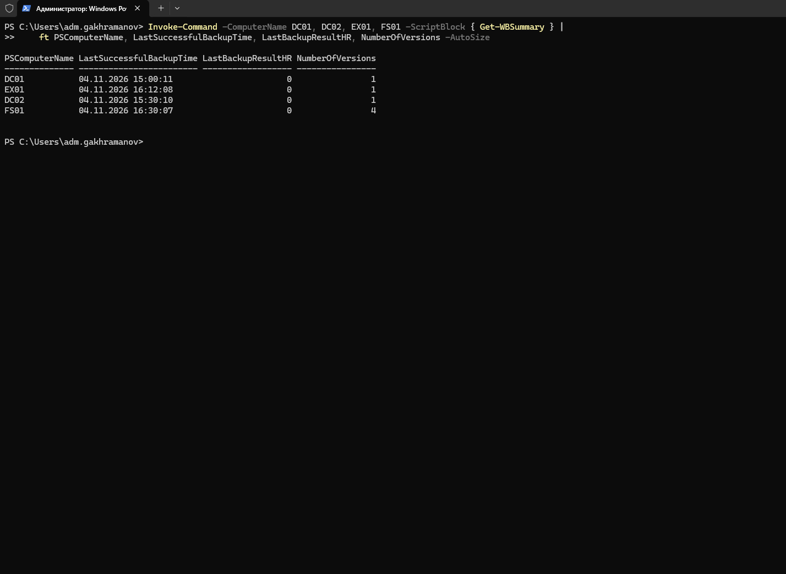</a> Бэкапы всех серверов: Get-WBSummary | <a href="screenshots/07-printers.png">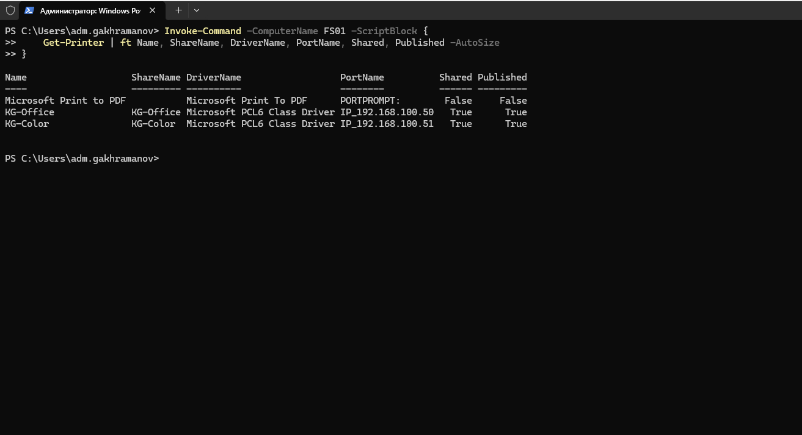</a> Принтеры на сервере печати |
| <a href="screenshots/08-monitoring.png">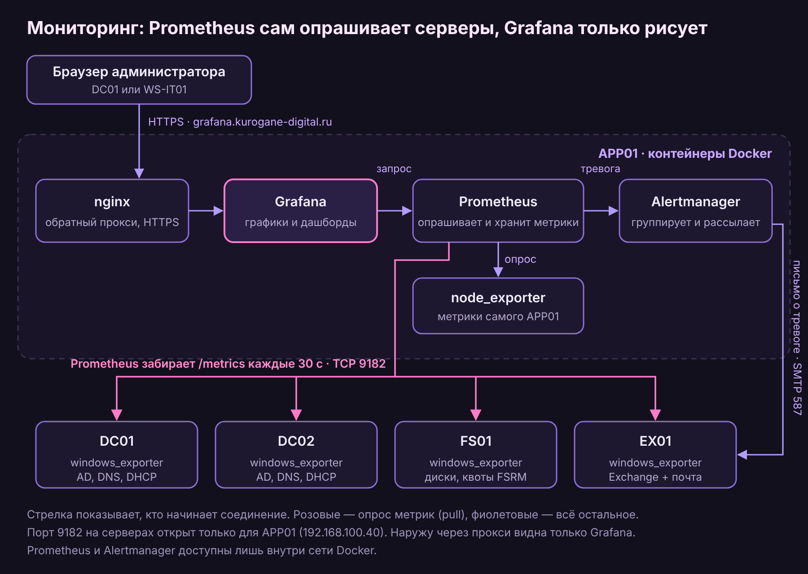</a> Схема мониторинга: кто кого опрашивает | <a href="screenshots/09-alert-email.png">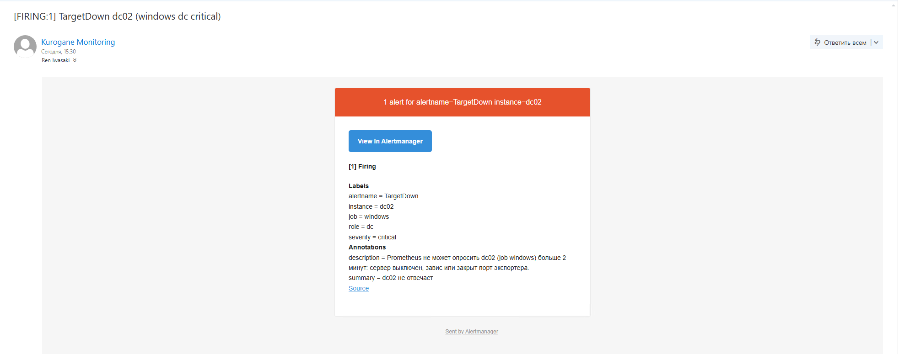</a> Письмо Alertmanager: DC02 недоступен |
| <a href="screenshots/10-grafana-windows.png">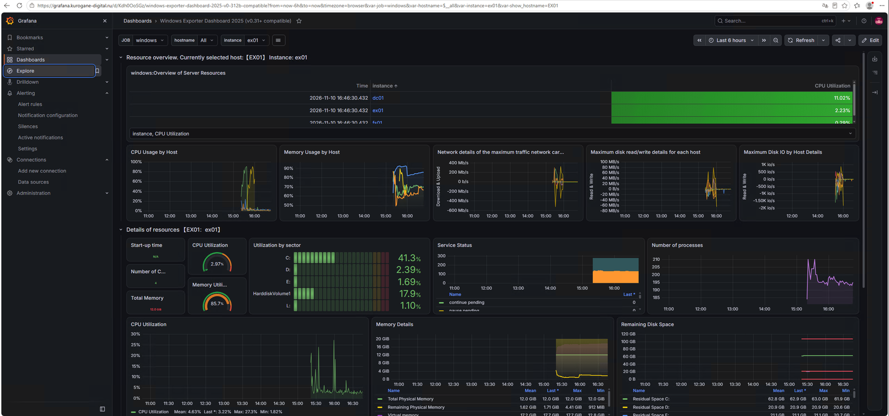</a> Grafana: серверы Windows, детали по EX01 | <a href="screenshots/11-prometheus-up.png">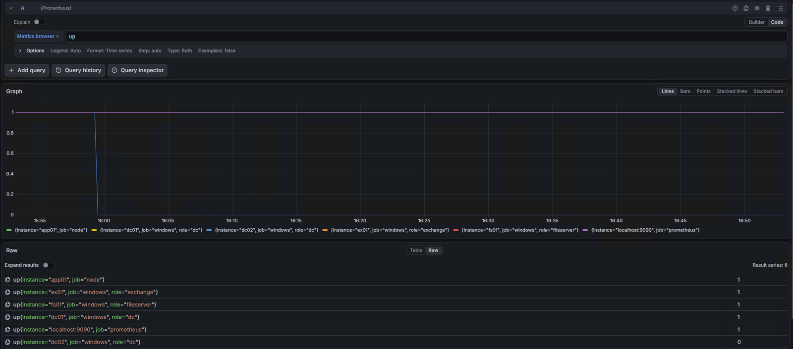</a> Метрика `up`: DC02 выключен — по ней сработала тревога TargetDown |
| <a href="screenshots/12-alert-rules.png">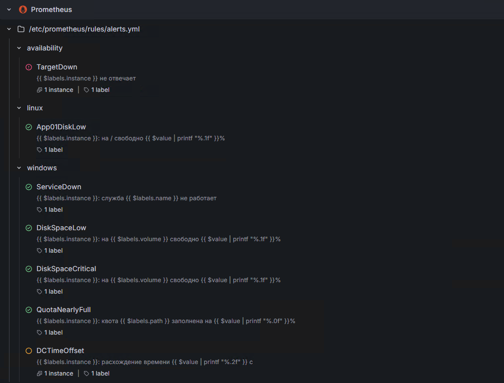</a> Семь правил тревог в Grafana: TargetDown горит, DCTimeOffset в ожидании | <a href="screenshots/13-glpi-ticket.png">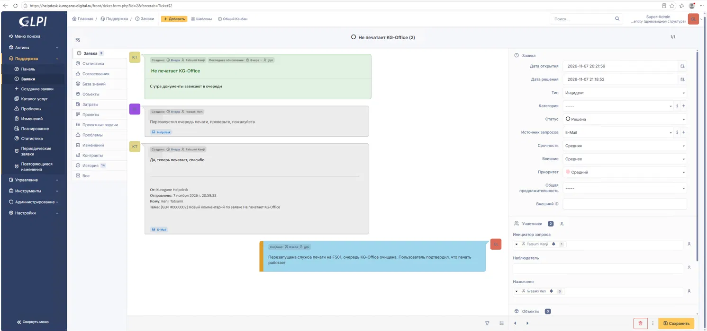</a> GLPI: заявка из письма, ответы по почте, решение |
| <a href="screenshots/14-intranet.png">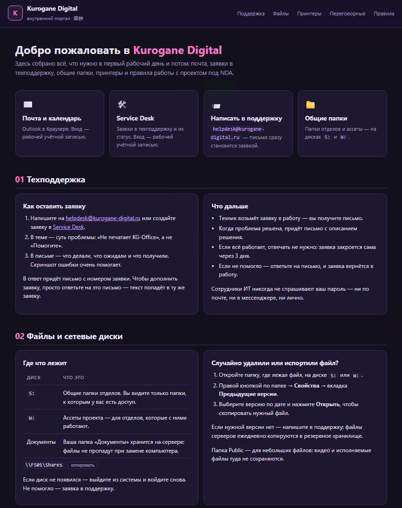</a> Портал сотрудников: intranet.kurogane-digital.ru | |

## Неполадки и их причины

Самое полезное в лабе — то, что ломалось. Все 83 случая собраны в [таблице проблем и решений](docs/troubleshooting.md). Несколько примеров:

- **Письма между ящиками не доставлялись: `501 5.1.4`.** Первый почтовый домен был в зоне `.test`, которую RFC 2606 резервирует для тестов, и Exchange отказывается на неё доставлять. Добавил домен `kurogane-digital.ru`, перевёл на него политику адресов и UPN пользователей — без пересборки леса.
- **При выключенном DC01 клиент показывал `LOGONSERVER = \\DC01`.** Переменная записывается при входе, а сеанс был старым или вход шёл по кэшированным учётным данным. Кто на самом деле выполняет проверку подлинности, видно через `klist` и `nltest /dsgetdc`.
- **Клиенты подключали принтер через `Microsoft enhanced Point and Print driver`, хотя нужный драйвер был установлен заранее.** Драйвер PCL6 Class относится к поколению v4, а для v4 Windows так делает намеренно. Ослаблять защиту от PrintNightmare не стал: для второго принтера перешёл на v3-драйвер HP, который ставится на клиенты скриптом автозагрузки. По пути выяснилось, что `pnputil` от SYSTEM отклоняет пакет с подписью самой HP, пока сертификат издателя не попадёт в «Доверенные издатели», — раздал его через GPO.
- **После передачи ролей FSMO `dcdiag /test:fsmocheck` не находил PDC.** Контроллер держал в кэше устаревший результат поиска. Помогли `ipconfig /flushdns` и `nltest /dsgetdc /pdc /force`. Вывод: роль FSMO хранится в AD, а её местоположение — в DNS, и после передачи проверяют оба.
- **Уведомления GLPI иногда падали по таймауту, а повтор через секунду проходил.** По протокольному журналу Exchange и журналу подключений выяснилось: после входа по SMTP фронтенд 12,7 секунды разрешал собственное имя, прежде чем передать сессию внутренней службе транспорта. У транспорта Exchange свой DNS-клиент, и он обращался к выключенному второму контроллеру домена; после сбоя сервер помечается недоступным, поэтому падала только первая отправка после простоя. Для лабы транспорт закреплён за DC01; версии с Netlogon, выбором DC, IPv6 и «холодным стартом» проверены и отброшены.
- **Тревога об остановке службы молчала, хотя «Диспетчер печати» на FS01 был остановлен.** Ни `promtool`, ни Prometheus ошибок не показывали. windows_exporter отдаёт имена служб в том регистре, в каком они зарегистрированы в Windows (`Spooler`, `NTDS`, `DHCPServer`), а регулярные выражения PromQL чувствительны к регистру. Помог флаг `(?i)`. Вывод: правило с ошибкой не падает, а молчит, поэтому каждую тревогу проверяю настоящей поломкой.

## Скрипты

| Скрипт | Что делает |
| --- | --- |
| [scripts/ad/New-KuroganeUsers.ps1](scripts/ad) | Создаёт пользователей из CSV в OU своего отдела и добавляет их в ролевые группы |
| [scripts/ad/New-KuroganeShareGroups.ps1](scripts/ad) | Создаёт группы доступа к папкам отделов и вкладывает в них ролевые группы по матрице доступа |
| [scripts/hyperv/Restore-LabNet.ps1](scripts/hyperv/Restore-LabNet.ps1) | Восстанавливает сеть лабы на хосте после сброса сети Windows; безопасно запускать повторно |
| [scripts/printing/Install-PrinterDrivers.ps1](scripts/printing/Install-PrinterDrivers.ps1) | Ставит драйверы принтеров при загрузке компьютера от SYSTEM, не ослабляя защиту Point and Print |
| [scripts/monitoring/Install-WindowsExporter.ps1](scripts/monitoring/Install-WindowsExporter.ps1) | Сценарий автозагрузки из GPO: определяет роли сервера, включает нужные сборщики windows_exporter и ставит или обновляет его; повторный запуск ничего не меняет |
| [configs/app01](configs/app01) | Конфигурация Linux-сервера: Docker Compose для GLPI, портала, мониторинга и nginx, правила тревог, SSSD, chrony, sudo; без паролей и ключей |

## Документы

- [Журнал лабы](docs/journal.md): обзор, все этапы с проверками, групповые политики, план. Есть [PDF-версия](docs/Kurogane-Journal.pdf).
- [Проблемы и решения](docs/troubleshooting.md): 83 случая.
- [Отчёт по групповым политикам](docs/gpo-report.html), выгруженный `Get-GPOReport`. Чтобы открыть его в браузере, скачайте файл.

## Что дальше

Zabbix для сравнения с Prometheus, GLPI Agent для инвентаризации, модель уровней администрирования (tiering), автоматизация на Ansible, IP-телефония, виртуальный маршрутизатор с VLAN вместо NAT на хосте.

---

Лаборатория учебная: имена, отделы и сотрудники вымышлены. Пароли, ключи центра сертификации и другие секреты в репозиторий не попадают.
