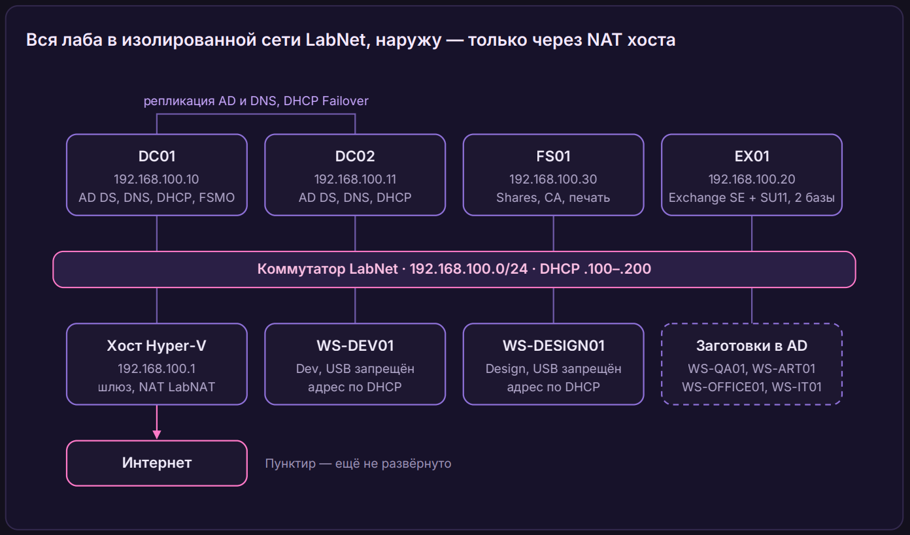

# Kurogane Digital — домашняя лаборатория Windows-инфраструктуры

> **In English.** A Hyper-V homelab that recreates the Windows infrastructure of a fictional 20-person game studio: two domain controllers with DNS and DHCP failover, a file server, Exchange Server SE, an enterprise PKI, Group Policy, backups verified by restore, and a print server. Every step is documented in a lab journal, including 56 troubleshooting cases with root causes. Documentation is in Russian.

Лаборатория воспроизводит инфраструктуру вымышленной игровой студии **Kurogane Digital** (黒鉄, «чёрная сталь»): около 20 сотрудников в семи отделах, игра под NDA, поэтому строгое разграничение доступа. Всё развёрнуто на одном ПК под Hyper-V на Windows Server 2025 и Windows 11.

Цель — практика системного администрирования на задачах, близких к реальной компании: не «установил роль», а «настроил, проверил и разобрал, что сломалось и почему». Каждый этап записан в [журнал](docs/journal.md) вместе с тем, как проверялся результат.

**Стек:** Windows Server 2025 · Active Directory DS · DNS · DHCP Failover · Group Policy · Windows LAPS · FSRM · Exchange Server SE · AD CS · Windows Server Backup · Print Server · PowerShell · Hyper-V

## Схема

| Машина | Роль | Адрес |
| --- | --- | --- |
| DC01 | AD DS, DNS, DHCP (активный), все роли FSMO, глобальный каталог | 192.168.100.10 |
| DC02 | AD DS, DNS, DHCP Failover (ждущий), глобальный каталог | 192.168.100.11 |
| FS01 | Файловый сервер, FSRM, теневые копии, центр сертификации, сервер печати | 192.168.100.30 |
| EX01 | Exchange Server SE (SU11), две базы почтовых ящиков | 192.168.100.20 |
| WS-DEV01, WS-DESIGN01 | Рабочие места отделов Dev и Design, Windows 11 | DHCP |

Лес `corp.kurogane.test`, почтовый домен и UPN — `kurogane-digital.ru`. Сеть изолирована: внутренний коммутатор Hyper-V, наружу — только через NAT на хосте.

## Что сделано

| Этап | Коротко | Подтверждение |
| --- | --- | --- |
| Active Directory | Лес с двумя контроллерами домена, репликация, сайт, время от PDC; структура OU по отделам; пользователи и группы создаются скриптом из CSV | [repadmin и dcdiag](screenshots/03-replication.png), [скрипты](scripts/ad) |
| DHCP Failover | Горячая замена между DC01 и DC02; отказ основного сервера проверен | [журнал](docs/journal.md#что-сделано) |
| Файловый сервер | Права по модели AGDLP, Access-Based Enumeration, квоты и блокировка файлов FSRM, теневые копии, личные папки | [журнал](docs/journal.md#что-сделано) |
| Групповые политики | 15 GPO: пароли и Fine-Grained Password Policy, Windows LAPS, диски и перенаправление папок по группам, запрет USB, вход на серверы, принтеры | [дерево GPO](screenshots/02-gpo-tree.png), [отчёт по всем GPO](docs/gpo-report.html) |
| Exchange Server SE | Установка по документации Microsoft, обновление безопасности, аудит HealthChecker; общие ящики и переговорные с правами через группы, динамические рассылки, смена почтового домена и UPN | [трекинг письма](screenshots/05-message-tracking.png) |
| PKI | Корпоративный корневой центр сертификации AD CS, свой шаблон, SAN-сертификат для Exchange, Download Domains | [сертификат в браузере](screenshots/04-owa-certificate.png) |
| Резервное копирование | Windows Server Backup на всех серверах, бэкап ключа ЦС; восстановление проверено: файл, объект AD, письмо через Recovery Database | [сводка по серверам](screenshots/06-backup-summary.png) |
| Тест отказа | DC01 выключен: вход, DNS и DHCP работают через DC02; передача ролей FSMO и возврат | [журнал](docs/journal.md#что-сделано) |
| Печать | Сервер печати, развёртывание принтеров по отделам через GPO, защита после PrintNightmare, служба печати отключена на контроллерах домена | [принтеры на сервере](screenshots/07-printers.png) |

## Неполадки и их причины

Самое полезное в лабе — то, что ломалось. Все 56 случаев собраны в [таблице проблем и решений](docs/troubleshooting.md). Несколько примеров:

- **Письма между ящиками не доставлялись: `501 5.1.4`.** Первый почтовый домен был в зоне `.test`, которую RFC 2606 резервирует для тестов, и Exchange отказывается на неё доставлять. Добавил домен `kurogane-digital.ru`, перевёл на него политику адресов и UPN пользователей — без пересборки леса.
- **При выключенном DC01 клиент показывал `LOGONSERVER = \\DC01`.** Переменная записывается при входе, а сеанс был старым или вход шёл по кэшированным учётным данным. Кто на самом деле выполняет проверку подлинности, видно через `klist` и `nltest /dsgetdc`.
- **Клиенты подключали принтер через `Microsoft enhanced Point and Print driver`, хотя нужный драйвер был установлен заранее.** Драйвер PCL6 Class относится к поколению v4, а для v4 Windows так делает намеренно. Ослаблять защиту от PrintNightmare ради «правильного» имени драйвера не стал.
- **После передачи ролей FSMO `dcdiag /test:fsmocheck` не находил PDC.** Контроллер держал в кэше устаревший результат поиска. Помогли `ipconfig /flushdns` и `nltest /dsgetdc /pdc /force`. Вывод: роль FSMO хранится в AD, а её местоположение — в DNS, и после передачи проверяют оба.

## Скрипты

| Скрипт | Что делает |
| --- | --- |
| [scripts/ad/New-KuroganeUsers.ps1](scripts/ad) | Создаёт пользователей из CSV в OU своего отдела и добавляет их в ролевые группы |
| [scripts/ad/New-KuroganeShareGroups.ps1](scripts/ad) | Создаёт группы доступа к папкам отделов и вкладывает в них ролевые группы по матрице доступа |
| [scripts/hyperv/Restore-LabNet.ps1](scripts/hyperv/Restore-LabNet.ps1) | Восстанавливает сеть лабы на хосте после сброса сети Windows; безопасно запускать повторно |
| [scripts/printing/Install-PrinterDrivers.ps1](scripts/printing/Install-PrinterDrivers.ps1) | Ставит драйверы принтеров при загрузке компьютера от SYSTEM, не ослабляя защиту Point and Print |

## Документы

- [Журнал лабы](docs/journal.md): обзор, все этапы с проверками, групповые политики, план. Есть [PDF-версия](docs/Kurogane-Journal.pdf).
- [Проблемы и решения](docs/troubleshooting.md): 56 случаев.
- [Отчёт по групповым политикам](docs/gpo-report.html), выгруженный `Get-GPOReport`. Чтобы открыть его в браузере, скачайте файл.

## Что дальше

Linux-сервер в домене, мониторинг на Prometheus и Grafana (и для сравнения Zabbix), Docker, автоматизация на Ansible, IP-телефония, виртуальный маршрутизатор с VLAN вместо NAT на хосте.

---

Лаборатория учебная: имена, отделы и сотрудники вымышлены. Пароли, ключи центра сертификации и другие секреты в репозиторий не попадают.
