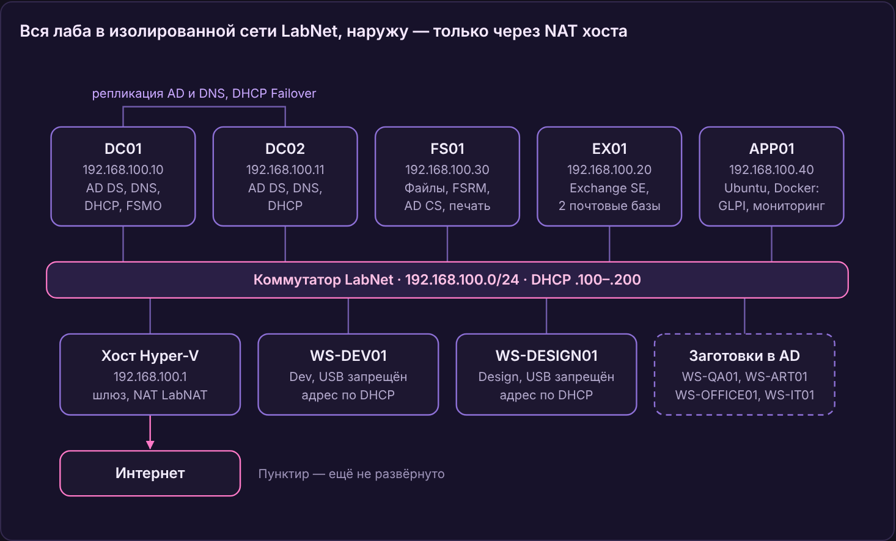

# Журнал лабы Kurogane Digital

> Полная версия журнала: обзор, все этапы с проверками, проблемы и решения, план. Есть и [PDF](Kurogane-Journal.pdf).

## Обзор

Лаба воспроизводит Windows-инфраструктуру вымышленной игровой студии Kurogane Digital на Hyper-V: два контроллера домена, файловый сервер, почтовый сервер и рабочие станции по отделам. Цель — практика администрирования AD, DNS, DHCP, групповых политик и файловых служб для портфолио и резюме.

**Легенда.** Kurogane Digital (黒鉄, «чёрная сталь») — дочерняя студия мегакорпорации, около 20 сотрудников в семи отделах: Dev, Design, Art, QA, Management, Finance, IT. Игра делается под NDA, поэтому в инфраструктуре строгое разграничение доступа, запрет USB у отделов с ассетами и баннер при входе.

**Хост.** 32 ГБ ОЗУ (16x2 6000CL30), 8 ядер / 16 потоков R7 9800X3D, Hyper-V, всё хозяйство в `C:\Lab\Kurogane` (ISO, Gold, VMs, Exports, Repo). Серверы развёрнуты из золотого образа Windows Server 2025 (sysprep), клиенты — Windows 11 Enterprise LTSC 2024.

**Сеть.** Внутренний коммутатор `LabNet`, подсеть 192.168.100.0/24, шлюз — хост 192.168.100.1 с NAT `LabNAT`. Статические адреса серверов до .99, DHCP-область `HQ-Clients` — .100–.200.

**Лес.** `corp.kurogane.test`, NetBIOS `KUROGANE`, функциональный уровень Windows Server 2016, сайт `HQ`. **Почта и логины** — `kurogane-digital.ru`: почтовый домен по умолчанию и UPN-суффикс пользователей (вход как `k.tatsumi@kurogane-digital.ru`). Первоначальный `kurogane.test` пришлось заменить — Exchange не доставляет почту на зарезервированную зону `.test`.

| Машина | Роль | IP | vCPU / ОЗУ | Диски | Состояние |
| --- | --- | --- | --- | --- | --- |
| DC01 | AD DS, DNS, DHCP (активный), все роли FSMO, GC | 192.168.100.10 | 2 / 1–4 ГБ, динамич. | C: 60 ГБ | работает |
| DC02 | AD DS, DNS, DHCP Failover (ждущий), GC | 192.168.100.11 | 2 / 1–4 ГБ, динамич. | C: 60 ГБ | работает |
| FS01 | Файловый сервер, FSRM, теневые копии, центр сертификации Kurogane-Root-CA (после установки AD CS сервер нельзя переименовать), сервер печати (KG-Office, KG-Color) | 192.168.100.30 | 2 / 1–4 ГБ, динамич. | C: 60 ГБ, D: Data 100 ГБ, B: Backup 200 ГБ (динамический) | работает |
| EX01 | Exchange Server SE | 192.168.100.20 | 4 / 12 ГБ, статич. | C: 100 ГБ; D:, E:, L: по 20 ГБ, фиксированные | Exchange SE RTM + SU11 (пробная версия), базы DB-Staff и DB-Management |
| WS-DEV01 | ПК программистов | DHCP | 2 / 1–4 ГБ, динамич. (при запуске 2 ГБ) | C: 80 ГБ | в домене |
| WS-DESIGN01 | ПК геймдизайнеров | DHCP | 2 / 1–4 ГБ, динамич. (при запуске 2 ГБ) | C: 80 ГБ | в домене |
| WS-QA01, WS-ART01, WS-OFFICE01, WS-IT01 | Стенд QA, ПК Art, Office, IT | DHCP | — | — | учётки созданы в AD, ВМ не развёрнуты |

Контроллеры домена реплицируются между собой и вместе раздают адреса; единственный выход наружу — через хост.

## Что сделано

За четыре дня поднята вся доменная часть: два DC с репликацией, отказоустойчивый DHCP, файловый сервер по модели AGDLP и 15 групповых политик. Exchange SE установлен и обновлён до SU11; почта настроена (ящики, общие ящики, ресурсы, рассылки); сертификаты выдаёт собственный центр AD CS; бэкапы всех серверов настроены и проверены восстановлением; принтеры раздаёт сервер печати на FS01 через GPO.

| Дата | Этап | Что сделано | Как проверено |
| --- | --- | --- | --- |
| 05.11.2026 | Печать: v3-драйвер | HP Universal Print Driver PCL6 8.2.0.26819 (v3, package-aware): пакет в D:\\Drivers\\HPUPD на FS01, скрытая папка Drivers$ с чтением для «Прошедших проверку» (S-1-5-11 — включает учётки компьютеров); драйвер на сервере через pnputil /add-driver hpcu360u.inf и Add-PrinterDriver. KG-Color пересоздан на HP UPD с тем же портом, общим именем и правами (PermissionSDDL сохранён до удаления); KG-Office остался на v4 для сравнения. В C\_WS\_PrinterDrivers добавлен сертификат HP Inc. в «Доверенные издатели»; Install-PrinterDrivers.ps1 версии 2 — таблица «драйвер → INF», копирование пакета, проверка кода pnputil, лог в C:\\Windows\\Temp | На FS01: MajorVersion 3, IsPackageAware True, права KG-Color совпали (PermissionSDDL -eq → True). На WS-DESIGN01 после перезагрузки: сертификат HP Inc. в TrustedPublisher, в логе «Добавленные пакеты драйверов: 1» и \[new\]. У a.nakano: \\\\FS01\\KG-Color → HP Universal Printing PCL 6 (локальный v3-драйвер), \\\\FS01\\KG-Office → Microsoft enhanced Point and Print driver (v4) — обе схемы рядом |
| 04.11.2026 | Портфолио и GitHub | Скриншоты для портфолио (дерево GPO, репликация, сертификат OWA, трекинг письма, сводка бэкапов, принтеры) и карточки 4:5 для hh.ru; перед съёмкой удалено пустое дублирующее OU Kurogane\\ServiceAccounts. Публичный репозиторий github.com/D1nklage11/kurogane-homelab: README со схемой и этапами, журнал, таблица проблем, отчёт по всем GPO (Get-GPOReport), скрипты, скриншоты; .gitignore против ключей ЦС, KeePassXC и выгрузок реестра; коммиты подписаны адресом noreply GitHub | Get-WBSummary на 4 серверах — LastBackupResultHR 0; repadmin — 0 сбоев, dcdiag пройден; трекинг тестового письма — DELIVER за 28 с. Скрипты и отчёт GPO проверены на пароли (Select-String, cpassword) — секретов нет; git push прошёл, README отображается в корне репозитория |
| 04.11.2026 | Печать | Роль сервера печати на FS01; порты TCP/IP на 192.168.100.50 и .51 (принтеров по этим адресам нет — задания остаются в очереди); принтеры KG-Office и KG-Color на Microsoft PCL6 Class Driver (v4), общий доступ и публикация в AD. Права по AGDLP: на KG-Office печатают все, на KG-Color — только DL\_PRN\_KG-Color\_Print (GG\_Art, GG\_Design); техподдержка — DL\_PRN\_ManageDocuments (GG\_Helpdesk) с печатью и управлением документами. GPO U\_Printers: KG-Office всем и по умолчанию, KG-Color с нацеливанием по группе и удалением при выходе из неё. GPO C\_WS\_PrinterDrivers: сценарий автозагрузки ставит драйверы от SYSTEM (заготовка под v3-драйверы). GPO C\_DC\_DisableSpooler: «Диспетчер печати» отключён на DC01 и DC02 | a.nakano (Design) получает оба принтера, d.ogawa (QA) — только KG-Office, у k.tatsumi на KG-Color «Отказано в доступе»; клиенты подключаются через Microsoft enhanced Point and Print driver (норма для v4). Застрявшая очередь: техподдержка видит задания a.nakano и отменяет их; очистка спулера (остановка службы, удаление spool\\PRINTERS, запуск) — Get-PrintJob пустой. DC: Spooler Stopped и Disabled на обоих; Get-Printer -ComputerName FS01 показывает оба принтера, DC01 и DC02 — ошибка 0x800706d9 |
| 04.11.2026 | Тест отказа DC01 | DC01 выключен на ходу при работающих DC02, FS01 и WS-DEV01; проверены вход, DNS, DHCP и общие папки. После возврата DC01 — передача доменных ролей FSMO (PDC, RID, инфраструктура) на DC02 с переносом внешнего источника времени, затем всё возвращено на DC01 | Без DC01: LOGONSERVER \\\\DC02 после полного выхода, nltest /dsgetdc → DC02 (GC, KDC, TIMESERV); DNS отвечает через .11; ipconfig /renew — аренду продлил DHCP-сервер 192.168.100.11, DHCP Failover в CommunicationInterrupted; \\\\FS01\\Shares доступны. После возврата: repadmin без ошибок, DHCP сам вернулся в Normal; netdom query fsmo — все роли на DC01, w32tm: DC01 → pool.ntp.org, DC02 → DC01 |
| 03.11.2026 | Резервное копирование | Хранилище: динамический VHDX 200 ГБ на FS01 (том B: Backup), скрытая общая папка Backup$ на B:\\Servers — NTFS без наследования, только SYSTEM, Администраторы, Администраторы домена и svc\_backup (права заданы по SID). Служебная учётка svc\_backup в OU Service Accounts (пароль в KeePassXC), в «Операторах архива» домена (для DC) и локально на EX01. Включена корзина AD. Windows Server Backup на всех серверах через Invoke-Command. Расписания: DC01 15:00 и DC02 15:30 — System State в \\\\FS01\\Backup$; EX01 16:00 — тома D:, E:, L: полным VSS-бэкапом в \\\\FS01\\Backup$; FS01 16:30 — Bare Metal Recovery и D: на B: (с версиями). Ключ и база центра сертификации — Backup-CARoleService, плюс ветка реестра CertSvc и список шаблонов; копия вынесена на хост в C:\\Lab\\Kurogane\\Exports\\CA-Backup, ключ во вложениях KeePassXC. Циклическое ведение журналов Exchange выключено — журналы очищает полный бэкап | wbadmin get versions: версии DC01, DC02, EX01 (с «Приложениями» — данные Exchange) и FS01 (с Bare Metal Recovery). Корзина: тестовый пользователь удалён и возвращён Restore-ADObject. Файл: удалённый restore-test.txt восстановлен из бэкапа FS01 в B:\\Restore-Test. Exchange: LastFullBackup заполнен, событие ESE 224 об удалении журналов; безвозвратно удалённое письмо возвращено из бэкапа через Recovery Database и New-MailboxRestoreRequest |
| 02.11.2026 | Сертификаты (AD CS) | Корпоративный корневой центр Kurogane-Root-CA (Enterprise Root CA, RSA 4096, SHA256, 10 лет) на FS01 — без отдельной ВМ ради памяти хоста; на время установки — членство в «Администраторах предприятия». Шаблон Kurogane Web Server: копия «Веб-сервера», 2 года, экспортируемый ключ, устаревший CSP для совместимости с Exchange, заявка только у администраторов домена; опубликован на центре. Зона kurogane-digital.ru в DNS, интегрированном с AD: mail (A), autodiscover и download (CNAME). Адреса всех служб Exchange и Autodiscover переведены на mail.kurogane-digital.ru. SAN-сертификат на mail, autodiscover и download: запрос из EAC, подпись через certreq, назначен IIS и SMTP. Включены Download Domains | Клиенты домена доверяют Kurogane-Root-CA без GPO (корень пришёл из AD после gpupdate); OWA по https://mail.kurogane-digital.ru без предупреждений, цепочка до корня; вложения отдаются с download.kurogane-digital.ru; HealthChecker: «All known security issues … passed», новый сертификат на порту 443, Exchange Back End (444) остался на самоподписанном |
| 01.11.2026 | Уборка после Exchange | Системные учётки Exchange перенесены из Kurogane\\Users в Kurogane\\Mailboxes\\System; дополнительные адреса @kurogane.test и @corp.kurogane.test удалены у всех получателей, включая арбитражные ящики, после чего удалены и сами обслуживаемые домены; в New-KuroganeUsers.ps1 суффикс UPN заменён на kurogane-digital.ru | Get-Mailbox -Arbitration находит ящики в новой OU; Get-AcceptedDomain — только kurogane-digital.ru; тестовое письмо — DELIVER; все очереди пустые |
| 01.11.2026 | Exchange SE: настройка | Почтовый домен kurogane-digital.ru по умолчанию и политика адресов на него, UPN пользователей переведён на тот же суффикс; база DB-Management на E: с журналами на L:, циклическое ведение журналов на обеих базах до настройки бэкапа; ящики 20 сотрудникам (Management и Finance — в DB-Management), у adm.gakhramanov ящик отключён; общие ящики bugs@ (Full Access и Send As для GG\_QA и GG\_Dev) и corp-liaison@ (GG\_Management) с копией отправленного; переговорные Room-Rooftop (12 мест, до 4 часов) и Room-Neon (4 места), стенд Neural-Rig-01 с согласованием через r.gakhramanov, список комнат Kurogane Rooms; динамические группы рассылки по OU отделов и all@, писать на которую может только руководство | Трекинг сообщений: SUBMIT → RECEIVE → SEND → DELIVER за 8 секунд; dev@ доходит до четырёх разработчиков; all@ от IT — NDR 550 5.7.124, от руководства — всем; bugs@ открывается у Dev, ответ уходит от Kurogane Bugs с копией в его «Отправленных», у Design доступа нет; Rooftop принимает бронь на час и отклоняет пересечение и встречу длиннее 240 минут; бронь стенда уходит на согласование |
| 01.11.2026 | Exchange SE: обновления | Обновления Windows; SU11 для Exchange SE RTM (KB5128895) с проверкой SHA256 по таблице хешей Microsoft, установка от имени администратора; аудит HealthChecker и исправления: схема питания «Высокая производительность», TCP KeepAliveTime 30 минут, отключён Credential Guard, файл подкачки фиксированный 8 ГБ | Exsetup.exe: 15.02.2562.056; Test-ServiceHealth: все три роли True; повторный HealthChecker: красным только Download Domains (отложено до AD CS), жёлтым — память 12 ГБ, файл подкачки и пробная лицензия |
| 01.11.2026 | Exchange SE | EX01 в домене и в OU Servers, C: расширен до 100 ГБ; тома D:, E:, L: в NTFS с кластером 64 КБ; компоненты Windows, Visual C++ 2012 и 2013, IIS URL Rewrite, UCMA 4.0 по документации Microsoft; подготовка AD (/PrepareSchema, /PrepareAD с организацией Kurogane, /PrepareAllDomains) с временными правами схемы и предприятия; установка роли Mailbox с первой базой DB-Staff на D: и журналами на L:; расширенная защита включена установщиком | Get-ExchangeServer: сборка 15.2.2562.17, StandardEvaluation; база DB-Staff смонтирована; все службы с автозапуском работают; EAC открывается с EX01 и с клиента |
| 31.10.2026 | GPO, часть 3 | Схема AD расширена под Windows LAPS (временно членство в «Администраторах схемы»), права компьютеров на OU `Computers`, `C_WS_LAPS`; `C_QA_LocalAdmins`; `C_SRV_Logon`; детальная парольная политика `PSO_Admins`; группа `GG_Helpdesk` и делегирование сброса паролей и разблокировки на `Kurogane\Users`; OU `Workstations\IT`; заготовки WS-QA01, WS-ART01, WS-OFFICE01, WS-IT01 | `Get-LapsADPassword`, `Get-ADUserResultantPasswordPolicy`, сброс пароля под `r.iwasaki`; проверка QA-админов отложена до WS-QA01 |
| 31.10.2026 | GPO, часть 2 | Баннер NDA, автоблокировка 600 с, запрет контрольных вопросов; запрет USB для Art, Dev, Design; вход пользователей через расширенный сеанс; обои и экран блокировки через NETLOGON | `gpresult /h` для WS-DEV01 и `k.tatsumi` без ошибок, `Deny_All = 1` в реестре |
| 30.10.2026 | GPO, часть 1 | Парольная политика домена (12 символов, журнал 24, блокировка после 10 попыток); ожидание сети; диски S: и W: с нацеливанием по группам; перенаправление «Документов» в `\\FS01\Home$` | Диски и путь «Документов» у `v.belova` и `k.tatsumi`, отчёт `gpresult` |
| 30.10.2026 | FS01, часть 2 | Квоты FSRM: Assets 30 ГБ жёсткая, Public 5 ГБ мягкая; блокировка видео и исполняемых файлов в Public; теневые копии тома D: (10 ГБ); скрытый ресурс `Home$` со схемой прав СОЗДАТЕЛЬ-ВЛАДЕЛЕЦ | Сотрудник другого отдела не видит чужую личную папку |
| 30.10.2026 | FS01, часть 1 | Роли «Файловый сервер» и FSRM; 13 групп `DL_FS_*` скриптом; 8 папок отделов с NTFS-правами; ресурс `\\FS01\Shares` с ABE | «Действующие разрешения» и вход под пользователями разных отделов |
| 29.10.2026 | DHCP Failover | Роль DHCP на DC02, отношение `HQ-Failover`, горячая замена, 5% адресов резервному, общий секрет | Служба DHCP на DC01 остановлена — клиент получил тот же адрес от 192.168.100.11 |
| 29.10.2026 | DC02 | Ввод в домен, повышение до DC с DNS и GC, DNS «крест-накрест» на обоих DC, DC02 вторым DNS в области DHCP | `repadmin /replsummary` без ошибок; тестовый пользователь создан на DC01 и удалён на DC02 |
| 29.10.2026 | Клиенты | WS-DEV01 и WS-DESIGN01 в домене и в OU своих отделов | Вход `k.tatsumi` и `a.nakano` со сменой пароля, `gpresult /r`, сайт HQ |
| 28.10.2026 | Структура AD | Дерево OU по отделам, UPN-суффикс, 7 ролевых групп `GG_*`, 19 сотрудников из CSV скриптом, отдельные учётки `adm.gakhramanov` и `r.gakhramanov` | 20 пользователей в OU, численность групп по отделам |
| 28.10.2026 | DC01 и DHCP | Лес `corp.kurogane.test`, обратная зона, пересылка на 1.1.1.1 и 8.8.8.8, сайт HQ, время с pool.ntp.org; область `HQ-Clients` | `dcdiag /q`, `nslookup`, `w32tm /query /status`, клиент получил 192.168.100.100 |
| 28.10.2026 | Hyper-V | Коммутатор `LabNet` с NAT, золотой образ Windows Server 2025 через sysprep, ВМ серверов и клиентов, фиксированные диски под базы Exchange | `Get-NetNat`, ВМ выходят в интернет |

### Групповые политики

| GPO | Привязана к | Что делает |
| --- | --- | --- |
| Default Domain Policy | домен | Пароль от 12 символов, сложность, без истечения срока, блокировка после 10 попыток на 15 минут |
| `C_WS_Security` | `Computers` | Баннер NDA, блокировка экрана через 10 минут, запрет контрольных вопросов |
| `C_WS_RDPUsers` | `Computers` | «Пользователи домена» в локальной группе RDP |
| `C_WS_Branding` | `Computers` | Копирует картинки из NETLOGON, задаёт экран блокировки |
| `C_WS_LAPS` | `Computers` | Пароль `localadmin`: 15 символов, смена раз в 30 дней, хранение в AD в зашифрованном виде |
| `C_WS_Baseline` | `Workstations` | Всегда ждать сеть при загрузке и входе |
| `C_WS_USBBlock` | `Workstations\Art`, `\Dev`, `\Design` | Запрет доступа ко всем съёмным накопителям |
| `C_QA_LocalAdmins` | `QA-Stands` | `GG_QA` в локальных администраторах |
| `C_SRV_Logon` | `Servers` | Локальный вход только для администраторов и операторов архива, RDP — только администраторам |
| `U_All_DriveMaps` | `Users` | S: = `\\FS01\Shares`, W: = папка своего отдела по группе |
| `U_All_FolderRedirection` | `Users` | «Документы» в `\\FS01\Home$\<логин>` с монопольным доступом |
| `U_All_Wallpaper` | `Users` | Корпоративные обои |
| U\_Printers | Users | Общие принтеры через предпочтения: KG-Office всем и по умолчанию; KG-Color — действие «Заменить», нацеливание по группе DL\_PRN\_KG-Color\_Print, удаление, когда политика перестаёт применяться |
| C\_WS\_PrinterDrivers | Workstations | Сценарий автозагрузки Install-PrinterDrivers.ps1 из NETLOGON ставит драйверы принтеров от SYSTEM (HP UPD v3 из \\\\FS01\\Drivers$); сертификат HP Inc. в «Доверенные издатели» |
| C\_DC\_DisableSpooler | Domain Controllers | Служба «Диспетчер печати» отключена (защита от PrintNightmare и Printer Bug) |

Отдельно от GPO действует `PSO_Admins` для «Администраторов домена»: пароль от 16 символов, срок 180 дней, блокировка после 5 попыток на 30 минут.

## Проблемы и решения

Большинство сбоев сводились к трём причинам: недоступный сервер, старый набор групп в токене до перезахода и русская локализация имён и кодировок.

| Что случилось | Почему | Как исправил |
| --- | --- | --- |
| Windows 11 не ставилась: «не отвечает требованиям» | В ВМ не был включён виртуальный TPM | Включил TPM в разделе «Безопасность», диск расширил до 80 ГБ |
| `Move-VMStorage`: «имена исходного и конечного файлов должны совпадать» | Командлет переносит диск, но не переименовывает его | Перенёс со старым именем, затем `Rename-Item` и `Set-VMHardDiskDrive` |
| `&&` в PowerShell — ошибка разбора | Оператор есть только в cmd и PowerShell 7 | Разбил на отдельные команды, `Restart-Service w32time` |
| `dcdiag` ругался на DFSREvent и SystemLog после создания леса | DFSR и Netlogon стартовали раньше, чем поднялись домен и DNS | Проверил событие 4602 и SRV-запись; следы ушли через 24 часа |
| Скрипт не запускался: «не имеет цифровой подписи» | Политика RemoteSigned и метка «скачан из интернета» | `Unblock-File` для проверенного файла, политику не ослаблял |
| Скрипт падал: «отсутствует завершающий символ» | Кириллица в UTF-8 без BOM читается PowerShell 5.1 как Windows-1251 | Переписал скрипт и CSV на английском (или сохранять в UTF-8 с BOM) |
| Трое геймдизайнеров не попали в группу | Группа `GG_Design` не была создана; скрипт печатал «Created» после непрерывающей ошибки | Создал группу и добавил их вручную; следующий скрипт уже с `try/catch` |
| Админская учётка не входила на DC: «метод входа запрещён» | На DC локально входят только администраторы, а учётка не была в «Администраторах домена» | Добавил в группу и перезашёл |
| Доменный пользователь не входил в расширенном сеансе Hyper-V | Расширенный сеанс работает как RDP, а права на RDP-вход не было | Обычный сеанс, позже GPO `C_WS_RDPUsers` |
| Нет доступа к свойствам папки под админом | UAC: проводник работает с отфильтрованным токеном | «Дополнительно» → «Продолжить» со щитом, без добавления себя в права лично |
| `\\FS01\Shares` недоступен с клиента | Папка и права были, но общий ресурс не создан (`Get-SmbShare`) | Опубликовал `Shares` с ABE |
| «СОЗДАТЕЛЬ-ВЛАДЕЛЕЦ» не находился при выдаче прав | Это встроенный субъект компьютера, а поиск шёл в домене | Выбрал из списка с размещением FS01 |
| Админ не открывает «Документы» пользователя на FS01 | Перенаправление с монопольными правами пользователя | Так задумано; доступ при необходимости — через смену владельца |
| Картинки не копировались на клиенты | В источнике был локальный путь DC `C:\Windows\SYSVOL\...` | Сетевой путь `\\corp.kurogane.test\NETLOGON\Branding\...` |
| `C_WS_USBBlock` не применялась и не видна даже среди отфильтрованных | Настройка лежала в «Конфигурации пользователя», а GPO привязана к OU с компьютерами (редакция компьютера 0) | Перенёс параметр в «Конфигурацию компьютера»; нашёл по вкладке «Настройки» в GPMC |
| `gpresult`: «не имеет данных RSOP», затем пустая и устаревшая пользовательская часть | Отчёт строился для админа из OU `Admins`; `/user` показывает данные последнего входа | `gpresult /h ... /user KUROGANE\k.tatsumi` после свежего входа пользователя |
| Диски и перенаправление папок: ошибка 0x80070043 | Файловый сервер FS01 был выключен («не найдено сетевое имя») | Включил FS01; порядок запуска лабы: DC → FS01 → клиенты |
| `Update-LapsADSchema`: «недостаточно прав» | Группа «Администраторы схемы» ещё не попала в токен до перезахода | Вышел и вошёл, проверил `whoami /groups \| Select-String "\-518"`, после обновления удалил себя из группы |
| `findstr` не находил русское имя группы | Расхождение кодировок консоли | Поиск по номеру группы (RID), а не по имени |
| Кнопка ОК неактивна в праве «Локальный вход в систему» | `BUILTIN\Администраторы`, введённый текстом, не сопоставился с группой | Выбрал группы через поиск из контейнера `Builtin` |
| Не удавалось расширить диск C: на EX01 | Между C: и свободным местом стоял раздел восстановления на 907 МБ | reagentc /disable, удалил раздел в diskpart, расширил C:, reagentc /enable |
| Тома под базы и журналы Exchange оказались с кластером 4 КБ | Размер кластера по умолчанию при форматировании | Переформатировал D:, E:, L: с кластером 64 КБ, проверил через fsutil fsinfo ntfsinfo |
| Start-Service MSExchangeDiagnostics: «Не удалось открыть службу» | Exchange Management Shell запущен без повышения прав (UAC) | Запустил консоль от имени администратора, служба стартовала |
| Браузер на https://ex01/ecp: NET::ERR\_CERT\_AUTHORITY\_INVALID | Exchange использует самоподписанный сертификат, которому другие ПК не доверяют | Ожидаемо для свежей установки; исправление — свой центр сертификации AD CS (в плане) |
| Test-ServiceHealth после установки SU: RequiredServicesRunning False, не запущена WinRM | У WinRM отложенный автозапуск, а проверка была сразу после перезагрузки | Подождал несколько минут, повторная проверка — все роли True. После перезагрузки Exchange даю ему 3–5 минут |
| HealthChecker: Credential Guard Enabled: True, хотя я его не включал | Windows Server 2025 включает Credential Guard по умолчанию на доменных серверах, а Exchange его не поддерживает | LsaCfgFlags = 0 в HKLM\\SYSTEM\\CurrentControlSet\\Control\\Lsa и HKLM\\SOFTWARE\\Policies\\Microsoft\\Windows\\DeviceGuard, перезагрузка; HealthChecker показывает False |
| HealthChecker упал с OutOfMemoryException после перехода на файл подкачки 3 ГБ (рекомендация 25% ОЗУ) | Лимит выделения памяти стал 12 + 3 = 15 ГБ, после старта служб Exchange занято 14,7 ГБ. Правило 25% рассчитано на серверы со 128+ ГБ ОЗУ | Фиксированный файл подкачки 8 ГБ (лимит 20 ГБ); предупреждение HealthChecker принято как осознанное отклонение от рекомендации |
| Письма между ящиками не доставлялись: в трекинге FAIL с кодом 501 5.1.4 Recipient address reserved by RFC 2606 | Почтовый домен kurogane.test в зоне .test, которую RFC 2606 резервирует для тестов; Exchange отказывается доставлять на такие адреса даже внутри организации. Ошибка проектирования лабы | Новый обслуживаемый домен kurogane-digital.ru по умолчанию, политика адресов переведена на него, UPN пользователей сменён на тот же суффикс; лес AD остался corp.kurogane.test, пересобирать ничего не пришлось |
| Set-CalendarProcessing сразу после создания ресурса: «Не удаётся открыть почтовый ящик … Microsoft System Attendant» | Настройки бронирования хранятся внутри ящика, а только что созданный ящик ещё не дошёл по репликации AD и до хранилища | Повторил команду через пару минут; в скриптах между New-Mailbox и Set-CalendarProcessing нужна пауза или повтор |
| Get-CalendarProcessing с тремя именами через запятую: ошибка преобразования параметра Identity | У командлетов Exchange параметр -Identity принимает только один объект | Get-Mailbox -RecipientTypeDetails RoomMailbox, EquipmentMailbox \| Get-CalendarProcessing |
| Системные учётки Exchange (SystemMailbox, Migration, FederatedEmail, DiscoverySearchMailbox) оказались в OU Kurogane\\Users среди сотрудников | Стандартный контейнер пользователей перенаправлен (redirusr) на OU=Users,OU=Kurogane, и /PrepareAD создал учётки там | Не удалять и не отключать; в рассылки не попадают благодаря встроенным исключениям фильтра MailboxUsers; перенос в отдельную OU — в плане |
| WS-DEV01 не запускалась: «В системе не хватает памяти» (0x8007000E) | На хосте 32 ГБ, из них 12 занимает EX01, плюс DC01, DC02, FS01 | Корректно завершил работу DC02 на время теста (AD, DNS и DHCP обслуживает DC01); для клиентов можно включить динамическую память |
| У r.gakhramanov в атрибуте Department стояло «ИТ» кириллицей, у остальных IT | Учётка заведена вручную, а не скриптом из CSV | Set-ADUser r.gakhramanov -Department IT; фильтры и отчёты по Department теперь не пропускают её |
| После удаления старого домена тестовое письмо не дошло и повисло в очереди Unreachable | Автозаполнение OWA подставило старый адрес k.tatsumi@kurogane.test; домена уже нет среди обслуживаемых, Exchange счёл его внешним, а соединителя наружу нет | Удалил подсказку (×) и выбрал адресата из адресной книги; письмо из очереди убрал Remove-Message -WithNDR $false. Вывод: при смене домена старые адреса оставляют дополнительными на месяцы, пока не обновятся кэши у пользователей |
| Мастер EAC не спросил путь для файла запроса сертификата | В Exchange SE запрос (.req) скачивается браузером в «Загрузки», а не сохраняется по UNC-пути, как в старых версиях | certreq -submit с файлом из Downloads (браузер заменил пробелы в имени на плюсы), затем Complete в EAC |
| Вывод certutil, переданный в Select-String, — кракозябры | certutil пишет по-русски в OEM-кодировке 866, а PowerShell читает конвейер в другой | \[Console\]::OutputEncoding = \[Text.Encoding\]::GetEncoding(866) перед командой; на самом деле там «Автозаявка: Отказано в доступе» — норма |
| С хоста OWA не открывался ни в Chrome, ни в Edge: ERR\_CONNECTION\_CLOSED, хотя ping и Test-NetConnection на порт 443 проходили | VPN-клиент на хосте заворачивал трафик браузеров к kurogane-digital.ru в туннель, мимо hosts; curl системный прокси не использует и доходил до EX01 напрямую | С выключенным VPN всё открывается; насовсем — исключения в VPN-клиенте для \*.kurogane-digital.ru и 192.168.100.0/24. Диагностика: Test-NetConnection (TCP) → curl -v (TLS без браузера) → браузер |
| curl с хоста: CRYPT\_E\_REVOCATION\_OFFLINE (0x80092013) | Хост вне домена не может получить список отзыва: CRL публикуется по LDAP в AD и по HTTP на FS01, где нет веб-сервера; Schannel в curl при этом строго обрывает соединение | Для проверки — curl --ssl-no-revoke; по-настоящему — публикация CRL по HTTP (пункт «PKI на будущее»). Доменные клиенты получают CRL по LDAP и проблемы не видят |
| HealthChecker: Common Services Not Running — MSComplianceAudit (аудит Exchange) остановлена, хотя Test-ServiceHealth показывал всё True | При загрузке EX01 служба не уложилась в таймаут 45 с (события 7009 и 7000 в журнале «Система») — Exchange на 4 vCPU и 12 ГБ стартует медленно; у Test-ServiceHealth свой список служб, этой в нём нет | Start-Service MSComplianceAudit, служба держится в Running; при повторении — ServicesPipeTimeout 120000 в HKLM\\SYSTEM\\CurrentControlSet\\Control. Диагностика: Get-WinEvent по Service Control Manager |
| Права на B:\\Servers не выставились: IdentityNotMappedException для BUILTIN\\Administrators и KUROGANE\\Domain Admins | На русской Windows группы называются «Администраторы» и «Администраторы домена», английские имена не находятся | Права заданы по SID: S-1-5-18, S-1-5-32-544, \<SID домена>-512; локализованное имя для New-SmbShare получено через .Translate(). Правило для скриптов: встроенные группы — только по SID |
| Мастер расписания WSB: «пользователь не входит в группу локальных администраторов или операторов архива» | Бэкап по расписанию в сетевую папку выполняется от имени указанной учётки, ей нужно право оператора архива на бэкапируемом сервере (я сначала ошибочно считал, что достаточно права записи в папку) | svc\_backup добавлена в «Операторы архива» (S-1-5-32-551): на DC это встроенная группа домена — сразу для всех контроллеров, а учётка становится уровня Tier 0; на EX01 — локально; на FS01 не нужна (бэкап на локальный том идёт от SYSTEM) |
| В мастере WSB нельзя выбрать «Не наследовать» для сетевой папки | Для бэкапа по расписанию WSB не умеет задавать отдельные права архиву | Архив наследует права B:\\Servers, которые закрыты заранее, — поэтому права на папку бэкапов настраивают до бэкапов |
| Invoke-Command на EX01: WinRMOperationTimeout, хотя Test-WSMan проходил | EX01 после загрузки долго не отвечал — Exchange нагружает сервер при старте | Повторный запуск прошёл; диагностика: Test-NetConnection -Port 5985 и Test-WSMan |
| После полного бэкапа журналов Exchange стало почти столько же (31 → 29) | Удаляются только журналы до checkpoint (уже записанные в базу); при \~30 журналах почти все были за checkpoint | Событие ESE 224 показало удалённый диапазон (поколения 0x7B–0x7E); очистка работает, нагляднее при сотнях журналов. Проверка: eseutil /mk E00.chk |
| certutil -ca.cert в PowerShell: «Ожидалось не более 1 аргументов» | PowerShell разрезает аргумент «-ca.cert» по точке на «-ca» и «.cert»; вне FS01 ещё и «нет локального ЦС» | Аргумент в кавычках ('-ca.cert') или запуск в cmd; с другой машины — -config "FS01.corp.kurogane.test\\Kurogane-Root-CA"; альтернатива — Export-Certificate из Cert:\\LocalMachine\\Root |
| После «Сброса сети» в Windows на хосте пропал адаптер vEthernet (LabNet), ВМ отвалились от сети | Сброс сети удаляет все сетевые адаптеры, включая виртуальные коммутаторы Hyper-V (Default Switch Hyper-V пересоздаёт сам, свои — нет); внутри ВМ настройки не меняются | Скрипт Restore-LabNet.ps1: коммутатор LabNet с тем же именем, 192.168.100.1/24 на хосте, NAT LabNAT, подключение сетевых адаптеров ВМ обратно; безопасно запускать повторно |
| При выключенном DC01 на клиенте LOGONSERVER показывал \\\\DC01, а nltest /dsgetdc — DC02 | LOGONSERVER записывается при входе: сеанс был старым (отключение вместо выхода) или вход шёл по кэшированным учётным данным — тогда переменная хранит прежний DC | Полный выход и вход — \\\\DC02. Надёжная проверка того, кто аутентифицирует: klist purge, обращение к ресурсу, klist («Вызванный KDC»); канал компьютера — nltest /sc\_query |
| netdom query fsmo «выполнена успешно», w32tm /query /source = DC01 — хотя DC01 выключен | Обе команды показывают настройку (кому назначена роль, откуда брать время), а не доступность | Состояние проверяют dcdiag /test:fsmocheck и w32tm /query /status (последняя синхронизация, Leap Indicator) |
| Move-ADDirectoryServerOperationMasterRole: «Отказано в доступе» на роли SchemaMaster | Роли леса передают только «Администраторы схемы» (схема) и «Администраторы предприятия» (именование), а adm.gakhramanov — только администратор домена | Переданы только доменные роли (PDC, RID, инфраструктура); для ролей леса — временно группы -518 и -519 по SID и перевход. Разница передачи и захвата: после захвата старый DC нельзя включать |
| ipconfig /all \| Select-String «DNS-серверы» показал только 192.168.100.10 | ipconfig печатает второй DNS-сервер на следующей строке без подписи, фильтр её не ловит | Get-DnsClientServerAddress -AddressFamily IPv4 — {192.168.100.10, 192.168.100.11} |
| После возврата ролей на DC01: dcdiag /test:fsmocheck на DC02 — DcGetDcName(PDC\_REQUIRED), ошибка 1355, «не удается найти PDC» | PDC ищут через DNS (SRV \_ldap.\_tcp.pdc.\_msdcs), а DC02 держал в кэше результат поиска времён передачи роли туда и обратно; запись в DNS уже указывала на DC01 | ipconfig /flushdns и nltest /dsgetdc:corp.kurogane.test /pdc /force → DC01 (флаги PDC, GTIMESERV); fsmocheck пройдена. Роль FSMO живёт в AD (хозяин) и в DNS (как найти) — после передачи проверяют оба; при необходимости nltest /dsregdns на новом хозяине |
| a.nakano не получила KG-Color через GPO, хотя состояла в DL\_PRN\_KG-Color\_Print | Нацеливание GPP проверяет группы из токена, выданного при входе, а группу добавили уже после входа | Выход и вход (whoami /groups показывает группу) — принтер появился. Тот же урок, что с «Администраторами схемы»: новое членство действует только после перевхода |
| Клиенты подключились через Microsoft enhanced Point and Print driver, хотя Microsoft PCL6 Class Driver поставлен на них заранее сценарием | PCL6 Class Driver — драйвер v4: для общих принтеров на v4 Windows по задумке подключает клиентов через посредника, а возможности принтера берёт с сервера. Предустановка помогает v3-драйверам; я ошибочно ожидал её эффекта и для v4 | Принято как норма для v4; сценарий с v3 (HP Universal Print Driver для KG-Color) — в плане. RestrictDriverInstallationToAdministrators = 0 не трогал: это возврат дыры PrintNightmare |
| Техподдержка не подключила KG-Color: «Указанные учётные данные не обеспечивают доступ к этому принтеру» | «Управление документами» действует на задания, а чтобы открыть очередь, нужно подключиться к принтеру — для этого требуется право «Печать» | DL\_PRN\_ManageDocuments получила на KG-Color ещё и «Печать» (техподдержке всё равно нужна пробная страница). Вывод: управление документами без печати не работает |
| Очистка спулера: Remove-Item не удалил FP00000.SHD и PP….TMP — «файл используется другим процессом» | FP\* — пул заранее созданных файлов спулера, .TMP — временный файл драйвера; их, скорее всего, ещё держал PrintIsolationHost.exe, который завершается позже службы | Само задание удалилось (Get-PrintJob пустой). Надёжный порядок: Stop-Service Spooler, завершить PrintIsolationHost, пауза 2 с, удаление, Start-Service |
| Test-Path \\\\FS01\\pipe\\spoolss — False, хотя сервер печати работает | Начиная с Windows 11 22H2 служба печати по умолчанию принимает подключения только по RPC over TCP; именованный канал spoolss не слушается (политика «Configure RPC listener settings») | Проверка через Get-Printer -ComputerName: FS01 отвечает списком принтеров, DC01 и DC02 — 0x800706d9 (конечная точка службы печати не зарегистрирована) |
| В Kurogane два похожих OU: «Service Accounts» и «ServiceAccounts» | Лишнее OU создано по ошибке на одном из этапов и осталось пустым; svc\_backup лежит в «Service Accounts» | Проверил содержимое Get-ADObject -SearchScope OneLevel, снял ProtectedFromAccidentalDeletion и удалил Remove-ADOrganizationalUnit. Без снятия защиты удаление отказывает даже администратору домена |
| Get-Printer -ComputerName FS01 с DC01: «Служба очереди печати недоступна» (0x800706ba) | Командлеты печати ходят на удалённый сервер через локальную службу печати, а на DC01 она отключена GPO C\_DC\_DisableSpooler | Invoke-Command -ComputerName FS01 { Get-Printer }. Вывод: принтерами управляют с рабочей станции администратора или на самом сервере печати, не с DC |
| Set-Printer KG-Color -DriverName "HP Universal Printing PCL 6": 0x80070032 «запрос не поддерживается» | Очередь нельзя перевести с v4-драйвера на v3 на лету: у них разная архитектура настроек. Если бы драйвера не было в системе, ошибка была бы 0x80070705 | Пересоздал принтер: сохранил настройки и PermissionSDDL (Export-Clixml), Remove-Printer, Add-Printer с тем же портом и именем общего ресурса, Set-Printer -PermissionSDDL. GPO «Заменить» вернуло подключение пользователям само. Add-Printer с HP UPD шёл несколько минут: драйвер опрашивает порт, а принтера на .51 нет |
| Скрипт автозагрузки не поставил HP UPD на WS-DESIGN01: pnputil — «Издатель каталога, подписанного с помощью Authenticode, ещё не является доверенным»; скрипт при этом написал \[new\] | Пакет подписан самой HP, а не Microsoft (WHQL). При ручной установке на FS01 Windows спросила «Доверять издателю?» и добавила HP в доверенные; у SYSTEM при загрузке окна нет — установка отклонена. Скрипт не проверял код завершения pnputil | Сертификат издателя взят из подписи hpcu360u.cat (Get-AuthenticodeSignature, Export-Certificate) и роздан через C\_WS\_PrinterDrivers → Политики открытого ключа → Доверенные издатели (только рабочие станции — осознанный компромисс). В скрипте — $LASTEXITCODE, -ErrorAction Stop и try/catch: в логе \[ok\], \[new\] или \[fail\] с причиной |

## Скрипты и файлы

Всё, что можно показать работодателю, собирается в `C:\Lab\Kurogane\Repo` и потом уходит в репозиторий на GitHub вместе с этим журналом. Пароли и база KeePassXC в репозиторий не попадают.

| Файл | Что это | Где использовался |
| --- | --- | --- |
| `users.csv` | 19 сотрудников: имя, логин, отдел, должность, OU | `C:\Scripts` на DC01 |
| `New-KuroganeUsers.ps1` | Создаёт пользователей из CSV в OU отдела, UPN `@kurogane-digital.ru (суффикс в переменной $upnSuffix)`, смена пароля при первом входе, вступление в `GG_<отдел>` | `C:\Scripts` на DC01 |
| `New-KuroganeShareGroups.ps1` | Создаёт 13 групп `DL_FS_*` и вкладывает в них ролевые группы по матрице доступа, с `try/catch` | `C:\Scripts` на DC01 |
| `kurogane_wallpaper_blockscreen.png`, `kurogane_city_wallpaper.png` | Экран блокировки и обои студии | `\\corp.kurogane.test\NETLOGON\Branding` |
| `report.html`, `report-user.html` | Отчёты `gpresult /h` для WS-DEV01 и `k.tatsumi` без ошибок | `C:\` на WS-DEV01 |
| Restore-LabNet.ps1 | Восстанавливает сеть лабы на хосте: коммутатор LabNet, адрес шлюза 192.168.100.1, NAT LabNAT, подключение ВМ; каждый шаг сначала проверяет текущее состояние | C:\\Lab\\Kurogane\\Repo на хосте, после сброса сети Windows |
| Install-PrinterDrivers.ps1 | Ставит драйверы из списка, если их ещё нет: встроенные — Add-PrinterDriver, сторонние — сначала pnputil из \\\\FS01\\Drivers$, с проверкой кода завершения и логом в C:\\Windows\\Temp; работает при загрузке от SYSTEM, поэтому не упирается в запрет установки драйверов пользователями | \\\\corp.kurogane.test\\NETLOGON\\Scripts, GPO C\_WS\_PrinterDrivers |

Для README ещё понадобятся: схема сети, скриншоты дерева OU и списка GPO в GPMC, экспорт настроек политик (`Get-GPOReport -All -ReportType Html`).

## Что осталось

Следующий большой этап — Linux-сервер LNX01 в домене — на нём держатся портал, Service Desk на GLPI, мониторинг, контейнеры и Ansible; остальное можно делать в любом порядке.

- [ ] Развернуть WS-QA01 и проверить: `GG_QA` в локальных администраторах, нет ключа `Deny_All`
- [ ] Развернуть WS-ART01 и проверить квоту 30 ГБ на диске W: (Assets)
- [ ] Развернуть WS-OFFICE01 для руководства и бухгалтерии (без блокировки USB)
- [ ] Развернуть WS-IT01 со своими настройками (отдельная GPO на OU Workstations\\IT: вход только для ИТ, WinRM, BitLocker), поставить RSAT, работать под `r.iwasaki`
- [ ] При желании: LAPS на серверах — права на OU `Servers` и отдельная GPO для встроенного «Администратора»
- [ ] При желании: `C_WS_USBReadOnly` для Office — запрет записи на флешки вместо полного запрета
- [x] EX01: ввод в домен, тома D:, E:, L: с кластером 64 КБ, подготовка AD, установка Exchange SE
- [x] Exchange: последнее обновление безопасности (SU11, KB5128895) и аудит HealthChecker с исправлением замечаний
- [x] Exchange: базы `DB-Staff` и `DB-Management`, ящики для сотрудников, общие `bugs@` и `corp-liaison@`, ресурсы `Room-Rooftop`, `Room-Neon`, `Neural-Rig-01`, группы рассылки по отделам
- [x] Порядок после Exchange: перенести системные учётки Exchange из Kurogane\\Users в отдельную OU, убрать kurogane.test и corp.kurogane.test из обслуживаемых доменов, в New-KuroganeUsers.ps1 заменить UPN на @kurogane-digital.ru
- [x] Сертификаты, после базовой настройки Exchange: корпоративный центр сертификации на AD CS, доверие к нему на ПК домена (приходит из AD само, без GPO), сертификат Exchange на имена `mail.kurogane-digital.ru` и `autodiscover.kurogane-digital.ru` с DNS-записями, назначение службам IIS и SMTP — EAC и OWA без предупреждений браузера; там же Download Domains (download.kurogane-digital.ru) против CVE-2021-1730 — последний красный пункт HealthChecker
- [ ] PKI на будущее: доверие к Kurogane-Root-CA на устройствах вне домена (Linux, pfSense; хост уже настроен вручную: корень в доверенных, имена в hosts), публикация CRL по HTTP, продление сертификата Exchange до ноября 2028
- [x] Резервное копирование: System State на DC, данные FS01, проверка восстановления файла; Exchange — бэкап баз через Windows Server Backup (VSS), после чего выключить циклическое ведение журналов и убедиться, что журналы очищаются после полного бэкапа
- [ ] Бэкапы на будущее: вторая копия вне FS01 (сейчас все бэкапы на одном сервере и одном диске хоста), оповещение в Zabbix, если за сутки нет события 4 в журнале Microsoft-Windows-Backup, контроль места на L: при нерегулярной работе лабы
- [x] Тест отказа: выключить DC01, проверить вход, DNS и DHCP через DC02, перенести роли FSMO
- [ ] Сайт студии: внутренний портал сотрудников (ссылка на OWA, контакты техподдержки, как подключить принтер, правила NDA) в контейнере nginx на LNX01 вместо отдельной ВМ на IIS; HTTPS-сертификат от Kurogane-Root-CA, запись intranet.kurogane-digital.ru. Исходный вариант — WEB01 на IIS в OU `Servers` — отложен ради экономии памяти хоста
- [ ] Linux: сервер `LNX01` (Ubuntu Server или Debian) в домене через realmd/SSSD, вход по SSH доменными учётками из `GG_IT`; на нём живут мониторинг и контейнеры
- [ ] Мониторинг: Prometheus + Grafana, как минимум Windows Exporter на серверах и контроллерах домена; алерты на заполнение квоты Assets, падение DC и остановку DHCP; для сравнения то же самое в Zabbix
- [ ] Docker на LNX01: Prometheus и Grafana в контейнерах, Vaultwarden как менеджер паролей студии; сайт-заглушку можно поднять в контейнере nginx вместо IIS
- [ ] Service Desk на GLPI: сервер в Docker на LNX01; вход доменными учётками через LDAP к AD, заявки привязаны к отделам; GLPI Agent на рабочих станциях — установка MSI-пакетом через GPO, инвентаризация железа и ПО; ящик helpdesk@kurogane-digital.ru в Exchange — письмо пользователя создаёт заявку, уведомления уходят через Exchange; отработать типовые заявки «от сотрудников» (принтер, пароль, диск W:)
- [ ] Ansible: управление Windows по WinRM — установка Windows Exporter на все серверы одним playbook, развёртывание сайта, базовая настройка новых ВМ
- [ ] IP-телефония: ВМ с FreePBX или Asterisk, softphone (например, MicroSIP) на клиентах, номера по отделам, группа вызова Helpdesk, голосовое меню, голосовая почта на Exchange, телефонная книга из AD по LDAP
- [ ] Сеть: виртуальный маршрутизатор pfSense или OPNsense вместо NAT на хосте; VLAN для серверов, клиентов и стенда QA, правила файрвола между ними; VPN (WireGuard или OpenVPN) для «удалённых» сотрудников
- [x] Печать без физического принтера: роль сервера печати на FS01, типовой драйвер (Microsoft PCL6 Class Driver или HP Universal Print Driver), порт TCP/IP на несуществующий адрес или на приёмник на порту 9100 (после появления LNX01 — задания приходят файлами); общий доступ и права на печать по группам отделов; развёртывание на ПК через GPO (Предпочтения → Принтеры с нацеливанием по отделам), принтер по умолчанию; Point and Print после PrintNightmare (установка драйверов только администраторами, список разрешённых серверов печати); отработать: зависшая очередь и очистка спулера, «принтер не появился», запрос драйвера без прав администратора; служба «Диспетчер печати» отключена на DC
- [x] Печать, продолжение: HP Universal Print Driver (v3) для KG-Color — поставить на FS01 и через Install-PrinterDrivers.ps1 на клиенты, убедиться, что клиент подключается с драйвером HP, а не через enhanced Point and Print; KG-Office остаётся на v4 для сравнения
- [x] Репозиторий на GitHub: README со схемой, таблица адресов, скрипты, этот журнал

## Источники

- [Предварительные требования для Exchange Server (Exchange SE, Exchange 2019) — Microsoft Learn](https://learn.microsoft.com/ru-ru/exchange/plan-and-deploy/prerequisites): по ней подготовлен EX01 (компоненты Windows, Visual C++ 2012 и 2013, IIS URL Rewrite, UCMA 4.0)
- [Security Update for Exchange Server SE RTM SU11 (KB5128895) — Microsoft Download Center](https://www.microsoft.com/en-us/download/details.aspx?id=108875)
- [Exchange Health Checker — CSS-Exchange](https://aka.ms/ExchangeHealthChecker)
- [Exchange Server 2019: internal email sent but not received (501 5.1.4, RFC 2606) — Microsoft Q&A](https://learn.microsoft.com/en-us/answers/questions/208018/exchange-server-2019-internal-email-sent-but-not-r)
